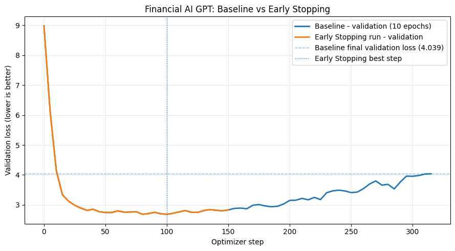

# Financial AI GPT — 금융 특화 텍스트 기반 GPT 학습 및 과적합 완화

> 금융 AI 관련 텍스트 구성 → GPT 학습 → 과적합 징후 관찰 → Early Stopping 적용 → 검증 손실·생성 결과 비교

대학원 컴퓨터특론(LLM) 수업을 기반으로 진행한 모델 학습·분석 프로젝트. 금융 AI·환각·RAG에 관한 한국어 자료를 선정해 **사전학습되지 않은 GPT 모델**을 훈련한 후, 검증 손실이 상승하는 구간을 관찰하고 Early Stopping과 최적 모델 체크포인트 선택 기능을 적용함.

**프로젝트 범위:** 금융 AI·RAG 관련 텍스트를 *학습 데이터*로 사용한 GPT 훈련 실험. 금융 AI 챗봇이나 RAG 검색 시스템을 구현하거나 금융 답변의 환각 감소율을 측정한 프로젝트는 아님.

## 핵심 결과

| 항목 | Baseline | Early Stopping 적용 |
|---|---:|---:|
| 훈련 종료 | 10에포크 / Step 315 | **5에포크 / Step 150** |
| 선택한 모델 | 마지막 모델 | **에포크 4 / Step 100 체크포인트** |
| 최종·복원 검증 손실 | **4.039** | **2.6831** |
| 해당 훈련 과정의 최저 검증 손실 | 약 2.683 | **2.6831** |
| 문장 생성 | 한국어 출력 불완전 | 한국어 출력 불완전 |

**해석:** 10에포크의 마지막 모델 대비 복원된 최적 모델의 검증 손실은 약 **33.6% 낮았음**. 이는 Baseline에서도 관찰된 최저 검증 손실과 같은 수준이며, 새로운 최고 성능을 달성했다는 의미는 아님. 목적은 **훈련 후반의 성능 저하 방지, 최적 가중치 자동 보존 및 불필요한 에포크 감소**에 있음.

## 데이터 및 훈련 환경

| 구분 | 설정 |
|---|---|
| 학습 텍스트 | 금융 AI·환각·검색증강생성(RAG) 관련 한국어 자료 |
| 데이터 규모 | **21,360 bytes · 9,249자 · GPT-2 토큰 18,253개** |
| 학습/검증 분할 | 문자 위치 기준 90:10 |
| 모델 | GPT-2형 Transformer 구성, **무작위 초기화** |
| 주요 구조 | 12 layers · 12 attention heads · emb_dim 768 · context length 256 |
| 훈련 | PyTorch · AdamW · learning rate 0.0004 · weight decay 0.1 |
| 평가 | Cross-Entropy Loss, 5 optimizer steps마다 |
| Early Stopping | 검증 손실 연속 10회 미개선 시 중단, 최적 상태 복원 |
| 실행 환경 | Google Colab / CUDA GPU |

## 코드 및 결과

**실행 결과가 포함된 노트북**
- [01. Baseline: GPT 10에포크 훈련](./notebooks/01_baseline_gpt_training.ipynb)
- [02. Early Stopping: 과적합 완화 비교](./notebooks/02_early_stopping.ipynb)

**실험 결과**
- [Baseline 손실 그래프](./results/baseline_loss.png)
- [손실 비교 그래프](./results/early_stopping_comparison.png)
- [Baseline 학습 기록 CSV](./results/baseline_loss_history.csv)
- [Early Stopping 평가 기록 CSV](./results/early_stopping_history.csv)
- [Early Stopping 결과 요약 JSON](./results/early_stopping_summary.json)
- [생성 텍스트 관찰 결과](./results/generation_samples.md)
- [실험 설계·결과 해석](./docs/experiment_method.md)

**실행 준비:** [데이터 출처 및 공개 범위](./data/README.md)와 [requirements.txt](./requirements.txt) 참고. 학습 코퍼스는 원문 저작물의 이용조건 때문에 **저장소에 포함하지 않음**. 노트북을 재실행하려면 적법하게 준비한 텍스트 파일을 `financial_ai_hallucination.txt`라는 이름으로 Colab에 업로드해야 하며, 다른 데이터 사용 시 동일한 손실을 재현하지 못할 수 있음.

## 수행 범위

- **수업 기반 코드:** GPT 아키텍처, Transformer 블록, 데이터 로더, 기본 훈련 루프
- **실습 수행:** 금융 AI 주제·자료 선정, 데이터 구성, GPU 학습, 손실 및 생성 결과 분석
- **추가 실험:** 검증 손실 기반 Early Stopping, 최적 체크포인트 저장·복원, Baseline 비교와 실험 기록 CSV/그래프 생성

## 한계 및 후속 과제

작은 한국어 코퍼스를 활용하여 무작위 초기화 모델을 훈련했으므로 한국어 생성 결과가 불완전함. GPT-2 토크나이저의 한국어 분절, 학습 규모, 프롬프트 언어 등은 가능한 원인이지만 요인별 기여도는 분리 검증하지 않음. 동일 검증 데이터로 체크포인트를 선택했으므로 **독립 테스트셋 성능 개선을 입증한 결과는 아님**.

향후 독립 테스트셋, 복수 시드, 데이터 확대, 사전학습 모델·한국어 토크나이저 비교를 통한 실험 확장 가능.
